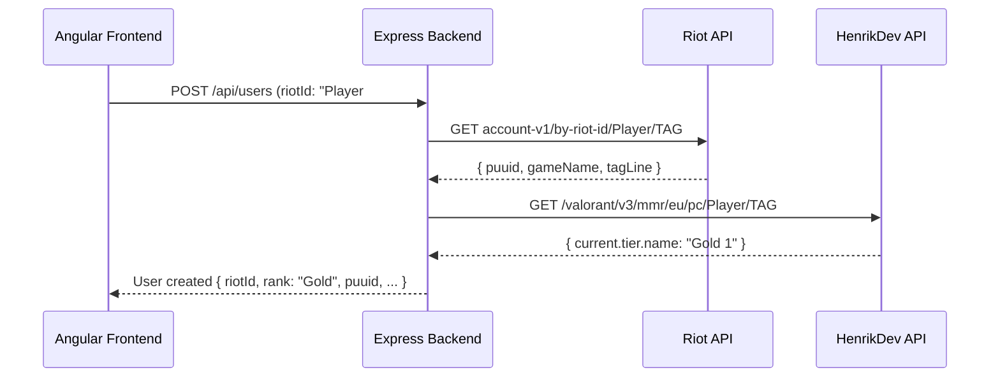

# Integrar API de Riot Games / HenrikDev

## Contexto critico

La API oficial de Riot para Valorant tiene acceso muy restringido: con una Development Key solo se puede usar `account-v1` (validar cuentas). Para datos de rango/MMR, la comunidad entera usa la **HenrikDev API** (gratuita, 30 req/min).

## Arquitectura




El frontend NUNCA llama a las APIs externas directamente. Todo pasa por el backend, que actua de proxy. Esto:

- Protege la API key (nunca se expone al cliente)
- Permite cachear datos
- Centraliza el manejo de errores y rate limiting

## Archivos a crear/modificar

### 1. Crear `server/services/riotService.js`

Servicio centralizado que encapsula las llamadas a ambas APIs:

- `validateAccount(gameName, tagLine)`: Llama a Riot `account-v1` para verificar que la cuenta existe. Devuelve `{ puuid, gameName, tagLine }`.
- `getPlayerRank(gameName, tagLine, region)`: Llama a HenrikDev `/valorant/v3/mmr/{region}/pc/{name}/{tag}`. Devuelve el tier actual (ej: "Gold 1") y lo normaliza a nuestro enum (ej: "Gold").
- Manejo de errores: 404 = cuenta no existe, 429 = rate limit, timeout, etc.
- Se necesita instalar `axios` para las llamadas HTTP.

### 2. Crear `server/routes/riotRoutes.js`

Nuevas rutas proxy:

- `GET /api/riot/validate/:gameName/:tagLine` - Valida si un Riot ID existe.
- `GET /api/riot/rank/:region/:gameName/:tagLine` - Obtiene el rango real del jugador.

### 3. Crear `server/controllers/riotController.js`

Controlador MVC con la logica de los endpoints de Riot.

### 4. Modificar `server/controllers/userController.js`

En `createUser`: Antes de crear el usuario, validar su Riot ID contra la API de Riot. Si no existe, devolver 404. Si existe, obtener su rango real de HenrikDev y guardarlo.

### 5. Modificar `server/models/User.js`

Annadir nuevos campos:

- `puuid` (String, unique) - Identificador unico de Riot.
- `region` (String, enum: eu, na, ap, kr) - Region del jugador.
- `accountLevel` (Number) - Nivel de cuenta.
- `cardImage` (String) - URL del avatar de Valorant.
- `lastRankUpdate` (Date) - Cuando se actualizo el rango por ultima vez.

### 6. Modificar `.env.example` y `docker-compose.yml`

Annadir variables:

- `RIOT_API_KEY` - Tu Development Key de Riot.
- `HENRIK_API_KEY` - Key de HenrikDev (gratuita, se obtiene en su web).

### 7. Actualizar `server/seed.js`

El seed seguira generando datos falsos (no podemos llamar a la API de Riot en un seed), pero annadira PUUIDs ficticios y regiones para que la estructura sea coherente.

### 8. Actualizar frontend

- Modificar `user.model.ts` para incluir los nuevos campos.
- Modificar `player-card.component` para mostrar avatar de Valorant y nivel de cuenta.
- Annadir `api.service.ts` metodos para validar Riot ID.

## Dependencias nuevas

- `axios` en el backend (para llamadas HTTP a Riot/Henrik)

## Variables de entorno necesarias

```
RIOT_API_KEY=RGAPI-xxxx-xxxx-xxxx   # Se obtiene en developer.riotgames.com
HENRIK_API_KEY=HDEV-xxxx-xxxx       # Se obtiene en docs.henrikdev.xyz (gratis)
```

## Rate limits a tener en cuenta

- **Riot Dev Key**: 20 req/segundo, 100 req/2 minutos. Caduca cada 24h.
- **HenrikDev API**: 30 req/minuto (plan gratuito).
- El servicio deberia implementar retry basico con backoff.

