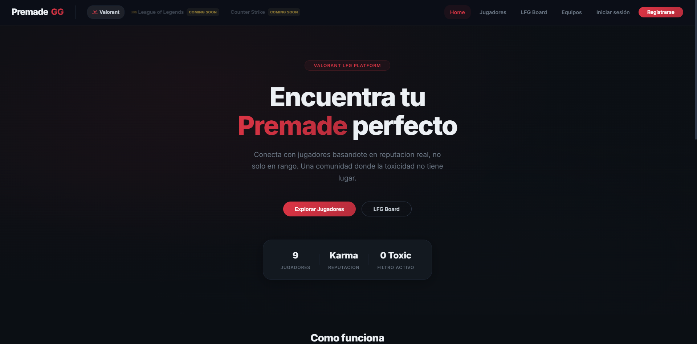
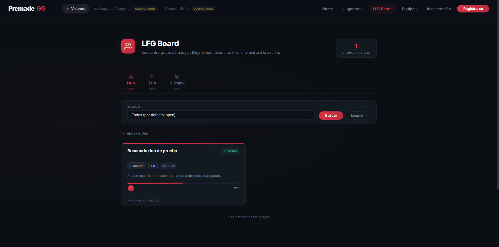
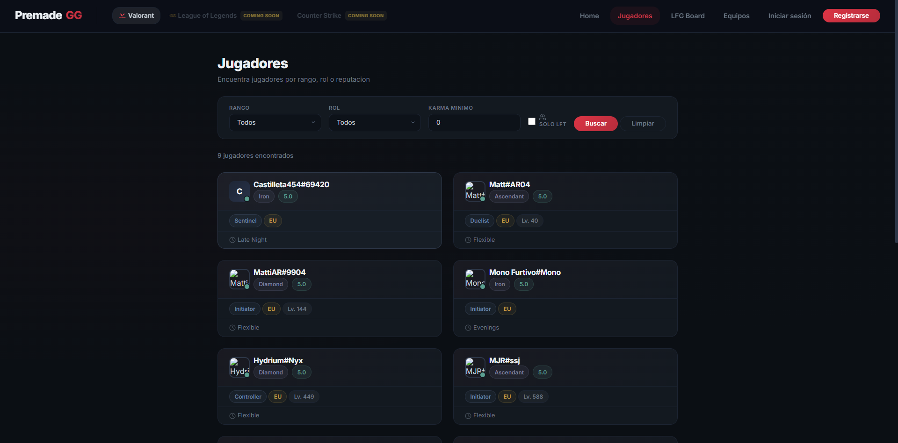
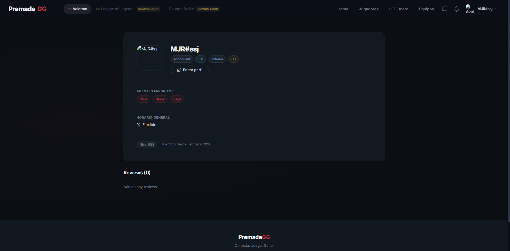
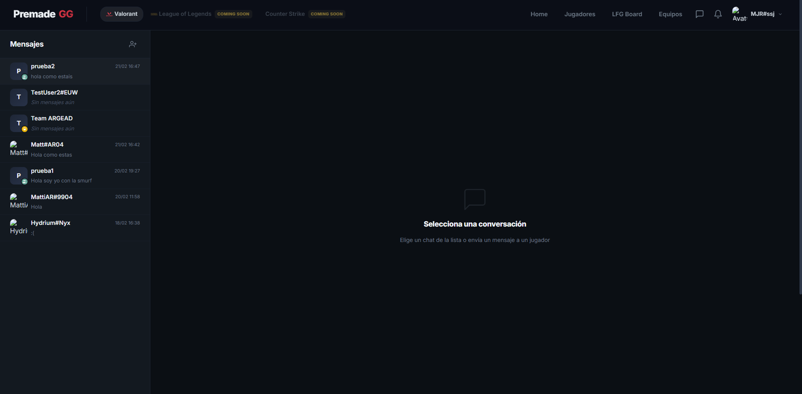
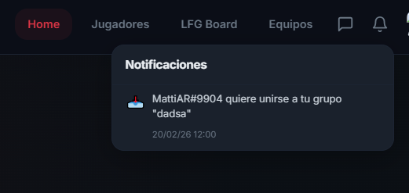
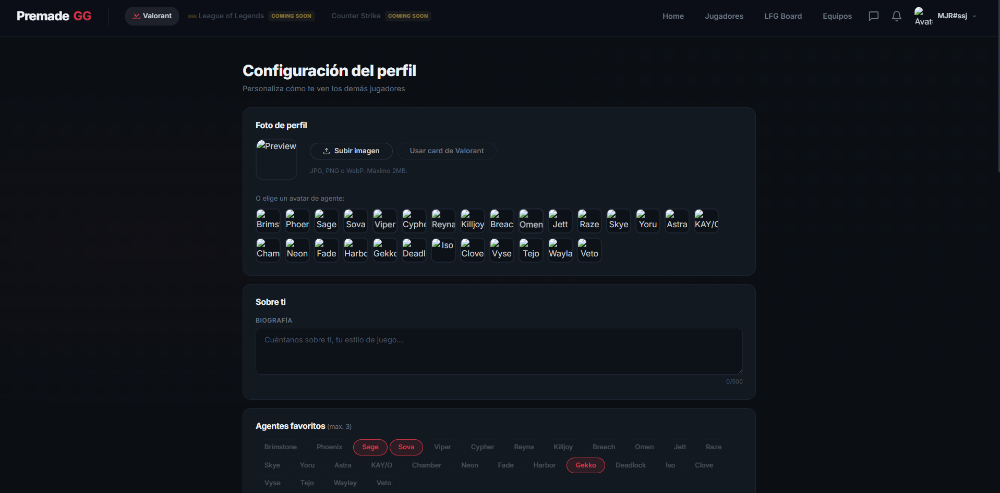
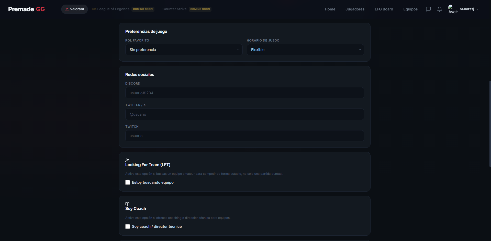
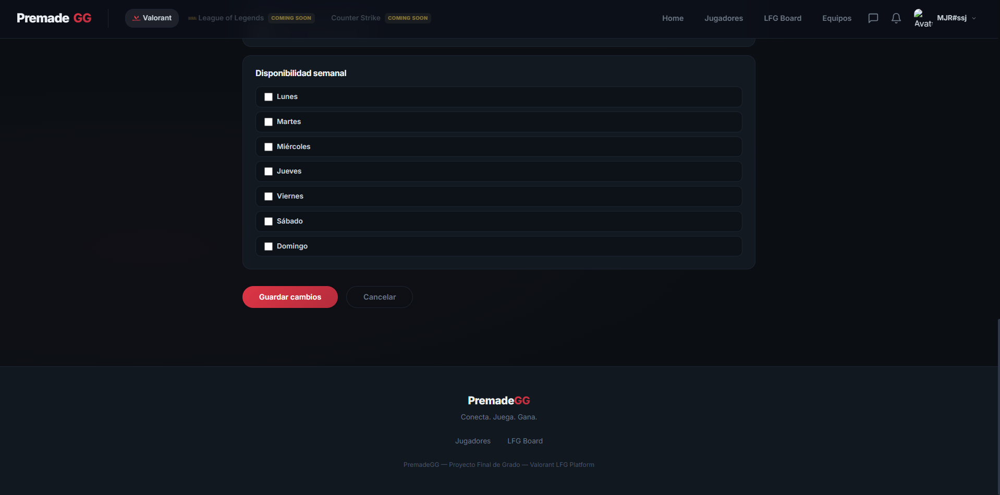
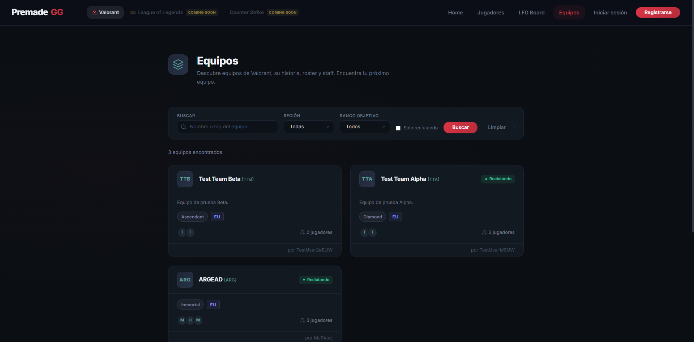

# PremadeGG - Valorant LFG Platform

**PremadeGG** es el proyecto final de grado diseñado para conectar jugadores de Valorant basándose no solo en su rango, sino en su reputación (Karma) y compatibilidad de roles.

## Visión del Proyecto
Una plataforma "Looking For Group" (LFG) que penaliza la toxicidad. Los usuarios con Karma < 3 son filtrados del matchmaking principal.

## 🎬 Video Explicativo
[](https://drive.google.com/file/d/1ghoKyXdTBNtKZwR7niyRDcn0XRcBcAn9/view?usp=sharing)

## 📸 Capturas de Pantalla

Vistas de la versión 1.0 (MEAN). El diseño actual ha cambiado: ver `CAMBIOS.md`.

### Inicio


### Board LFG


### Jugadores


### Perfil Público


### Mensajes y Notificaciones



### Configuración del perfil




### Equipos


## Stack Tecnológico (Angular + Supabase)
- **Angular 21**: Frontend con Standalone Components, signals y arquitectura SASS 7-1.
- **Supabase** (plan gratuito):
  - **Postgres**: base de datos relacional con Row Level Security.
  - **Auth**: email/contraseña, Google y Discord.
  - **Storage**: avatares de usuario.
  - **Realtime**: chat, indicador de "escribiendo…" y notificaciones en vivo.
  - **Edge Functions** (Deno): integración con Riot Games y HenrikDev sin exponer las API keys.
- **Vercel**: hosting del frontend.

> Hasta la versión 1.0 el proyecto usaba MEAN (MongoDB + Express + Socket.IO en Render).
> Se migró a Supabase para eliminar el *cold start* de Render, conservar los avatares
> (el disco de Render es efímero) y delegar la autenticación. El código anterior sigue en
> el historial de git.

## Estructura del Monorepo

### `/client` (Frontend)
- **Framework**: Angular (Latest).
- **Estilos**: SASS con metodología BEM y arquitectura por capas (`_utilities`, `_global`, `_components`).
- **Diseño**: Modo oscuro inspirado en Valorant (rojo #ff4655, tipografías Anton + Barlow, esquinas en corte diagonal).
- **Datos**: `services/supabase.client.ts` (cliente único + helpers `rpc()` / `invokeFunction()`),
  `services/api.service.ts`, `auth.service.ts`, `message.service.ts`, `realtime.service.ts`.

### `/supabase` (Backend)
| Ruta | Contenido |
|------|-----------|
| `migrations/…_schema.sql` | Tablas, enums e índices (port de los modelos Mongoose) |
| `migrations/…_helpers_rls.sql` | Serializadores JSON, políticas RLS y permisos |
| `migrations/…_api_read.sql` | RPC de lectura (listados paginados por cursor) |
| `migrations/…_api_write.sql` | RPC de escritura con las reglas de negocio |
| `migrations/…_triggers_cron.sql` | Perfil automático, recálculo de karma, notificaciones en tiempo real y limpieza programada |
| `migrations/…_storage.sql` | Bucket `avatars` y sus políticas |
| `functions/` | Edge Functions `riot-validate`, `riot-link`, `riot-refresh` |
| `seed.sql` | Datos de desarrollo |
| `tests/` | Tests pgTAP de seguridad (RLS) |

### `/scripts`
- `migrate-mongo-to-supabase.mjs`: migración única de los datos de MongoDB Atlas.

## Modelo de seguridad
- **Lectura**: RLS en todas las tablas. Perfiles, equipos, posts y reviews son públicos;
  conversaciones y mensajes solo los ven sus participantes; las notificaciones, su destinatario.
- **Escritura**: el cliente **no** puede hacer `INSERT/UPDATE/DELETE` directos. Toda escritura
  pasa por funciones RPC (`security definer`) que validan `auth.uid()` y las reglas de negocio
  (karma mínimo, rango mínimo, dueño del equipo…).
- **Datos de Riot** (`rank`, `puuid`, `riot_id`): solo los escriben las Edge Functions tras
  verificarlos con la API de Riot, así nadie puede falsear su rango.
- **Realtime**: canales privados `user:<id>` y `typing:<conversación>` protegidos por RLS.

## Requisitos Previos
- [Docker Desktop](https://www.docker.com/products/docker-desktop/) en ejecución (Supabase local).
- [Node.js >= 20](https://nodejs.org/).

## Cómo Arrancar (local)

### 1. Instalar dependencias
```bash
npm install
cd client && npm install
```

### 2. Levantar Supabase local
Desde la raíz del repo:
```bash
npm run db:start
```
Aplica las migraciones, carga `supabase/seed.sql` y muestra las URLs y claves locales:

| Servicio | URL |
|----------|-----|
| API Supabase | http://127.0.0.1:44321 |
| Studio (panel de BBDD) | http://127.0.0.1:44323 |
| Mailpit (emails de prueba) | http://127.0.0.1:44324 |

Copia la **Publishable key** que muestra el comando en `client/src/environments/environment.ts`.

### 3. Edge Functions (Riot API)
```bash
cp supabase/functions/.env.example supabase/functions/.env   # rellena RIOT_API_KEY y HENRIK_API_KEY
npm run functions:serve
```

### 4. Frontend
```bash
cd client
npm start
```
Abre http://localhost:4200.

### 5. Reiniciar la base de datos
```bash
npm run db:reset
```

### Cuentas de Prueba
El seed crea estos usuarios (todos con la contraseña **`password123`**):
- **Duelist**: `test1@premade.gg` (Dueño del "Test Team Alpha")
- **Controller**: `test2@premade.gg` (Dueño del "Test Team Beta", coach)
- **Initiator**: `test3@premade.gg` (Autor de publicaciones LFG)
- `player1@premade.gg` … `player20@premade.gg` con rangos, roles y reviews aleatorios.

## Scripts Disponibles (raíz)

| Script | Descripción |
|--------|-------------|
| `npm run db:start` / `db:stop` | Arranca / para Supabase local |
| `npm run db:reset` | Reaplica migraciones + seed |
| `npm run db:test` | Ejecuta los tests pgTAP de RLS |
| `npm run db:push` | Sube las migraciones al proyecto cloud enlazado |
| `npm run functions:serve` | Sirve las Edge Functions en local |
| `npm run migrate:mongo` | Migra los datos desde MongoDB (ver `DEPLOY.md`) |

## API (funciones RPC)
El frontend llama a estas funciones con `supabase.rpc(nombre, args)`. Devuelven JSON con la
misma forma que la antigua API REST (`_id`, camelCase, objetos poblados).

| Área | Lectura | Escritura (requiere sesión) |
|------|---------|-----------------------------|
| Perfil | `get_me`, `get_user`, `get_users`, `search_users` | `update_my_profile` |
| Reviews | `get_reviews`, `get_review_eligibility` | `create_review`, `delete_review` |
| LFG | `get_lfg_posts`, `get_lfg_post` | `create_lfg_post`, `update_lfg_post`, `delete_lfg_post`, `join_lfg_post`, `handle_lfg_member`, `leave_lfg_post` |
| Equipos | `get_teams`, `get_team` | `create_team`, `update_team`, `delete_team`, `set_team_coach`, `add_team_player`, `remove_team_player`, `add_team_staff`, `remove_team_staff`, `request_join_team`, `review_team_join_request` |
| Notificaciones | `get_notifications`, `get_unread_notification_count` | `mark_notification_read`, `mark_all_notifications_read`, `delete_notification` |
| Mensajes | `get_conversations`, `get_conversation`, `get_messages`, `get_unread_message_count` | `get_or_create_direct_conversation`, `create_group_conversation`, `send_message`, `mark_conversation_read` |

### Edge Functions
| Función | Auth | Descripción |
|---------|:----:|-------------|
| `riot-validate` | — | Valida un Riot ID (y opcionalmente su rango); indica si ya está registrado |
| `riot-link` | 🔒 | Onboarding: verifica el Riot ID y guarda rango, card y nivel en el perfil |
| `riot-refresh` | 🔒 | Actualiza rango/card del usuario (cooldown de 1 h) |

### Eventos Realtime (canal `user:<id>`)
`message:new`, `message:read`, `conversation:new`, `conversation:updated`, `conversation:removed`,
`notification:new`. En `typing:<conversación>`: `message:typing`, `message:stop-typing`.

## Reglas de Desarrollo (Rúbricas)
Este proyecto sigue rúbricas académicas estrictas:
1. **Sin "divitis"**: HTML semántico obligatorio.
2. **SASS Modular**: Uso exclusivo de `@use` y `@forward`.
3. **Clean Code**: Zero warnings en linter.
